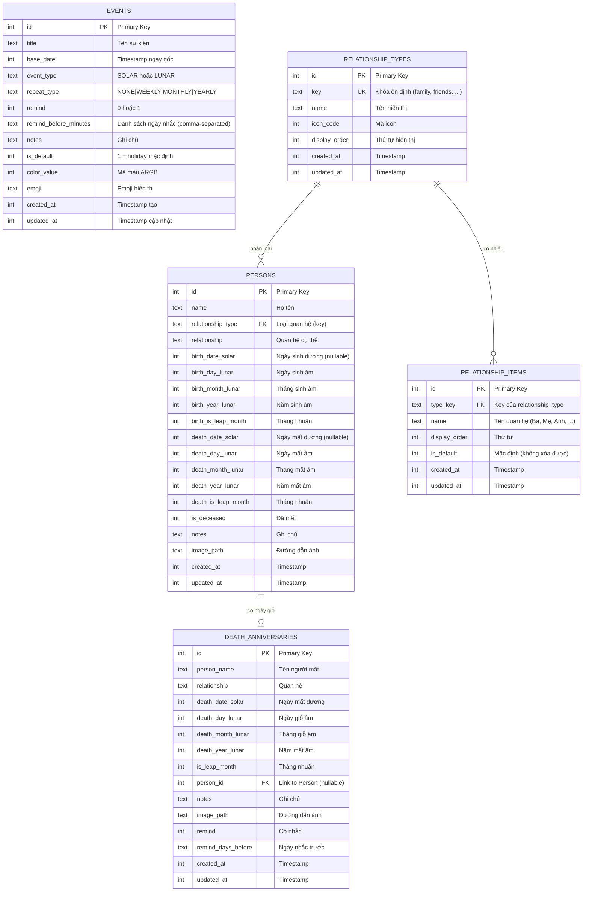
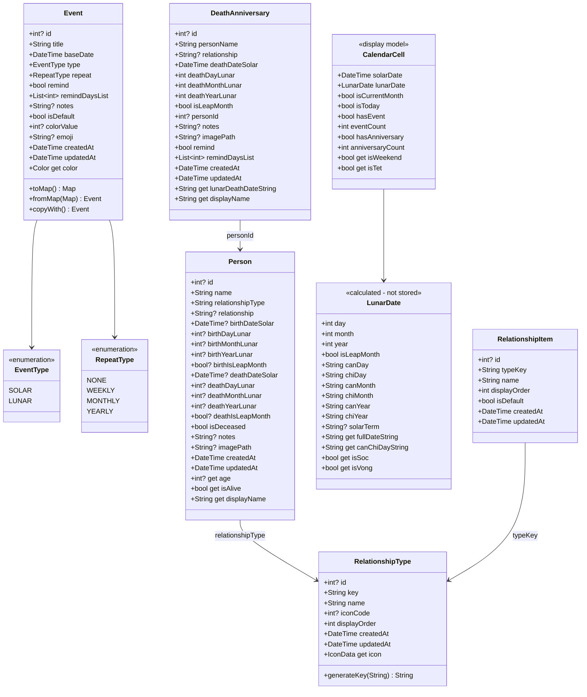
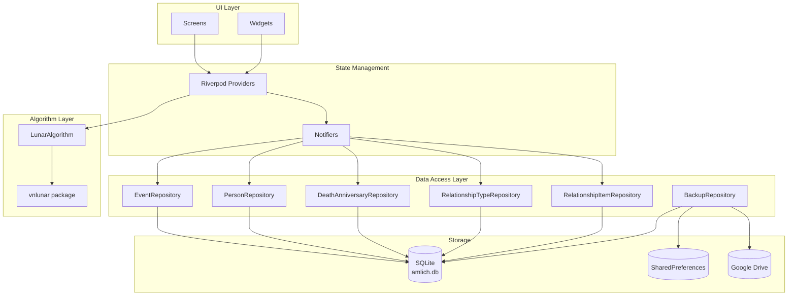
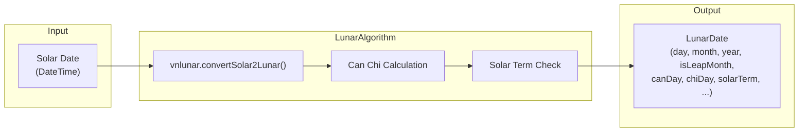
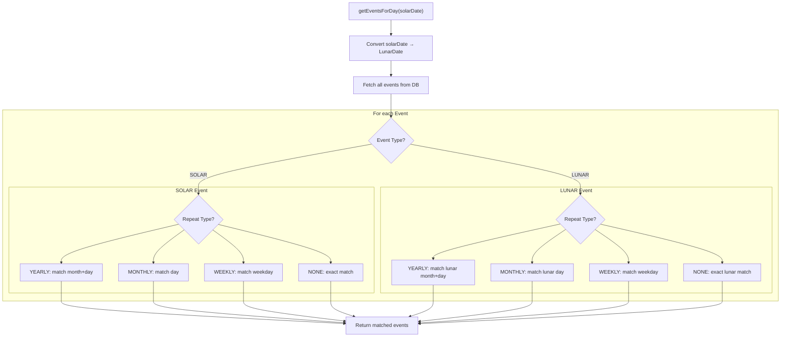
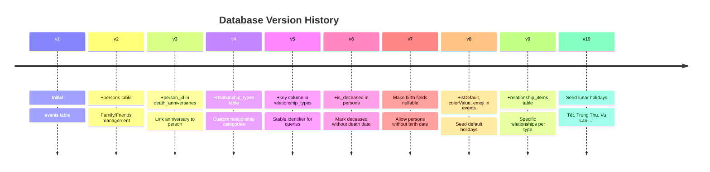
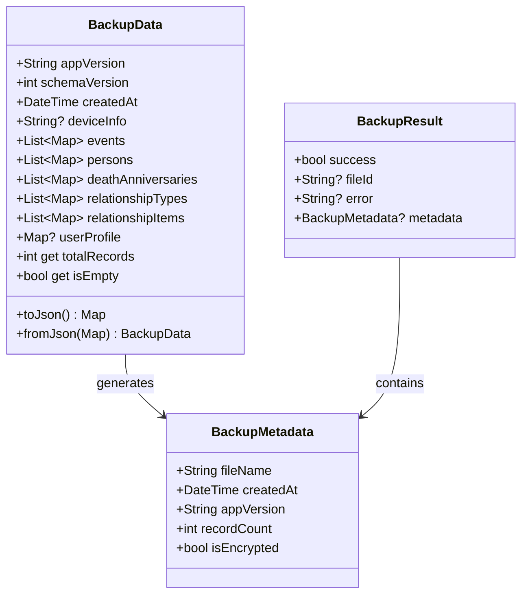

# Lịch Vạn Niên - Sơ đồ Quan hệ Dữ liệu

## 1. Entity Relationship Diagram

---

## 2. Domain Models Diagram

---

## 3. Data Flow Diagram

---

## 4. Lunar Date Calculation Flow

---

## 5. Event Matching Logic

---

## 6. Database Migration Timeline

---

## 7. Backup Data Structure

