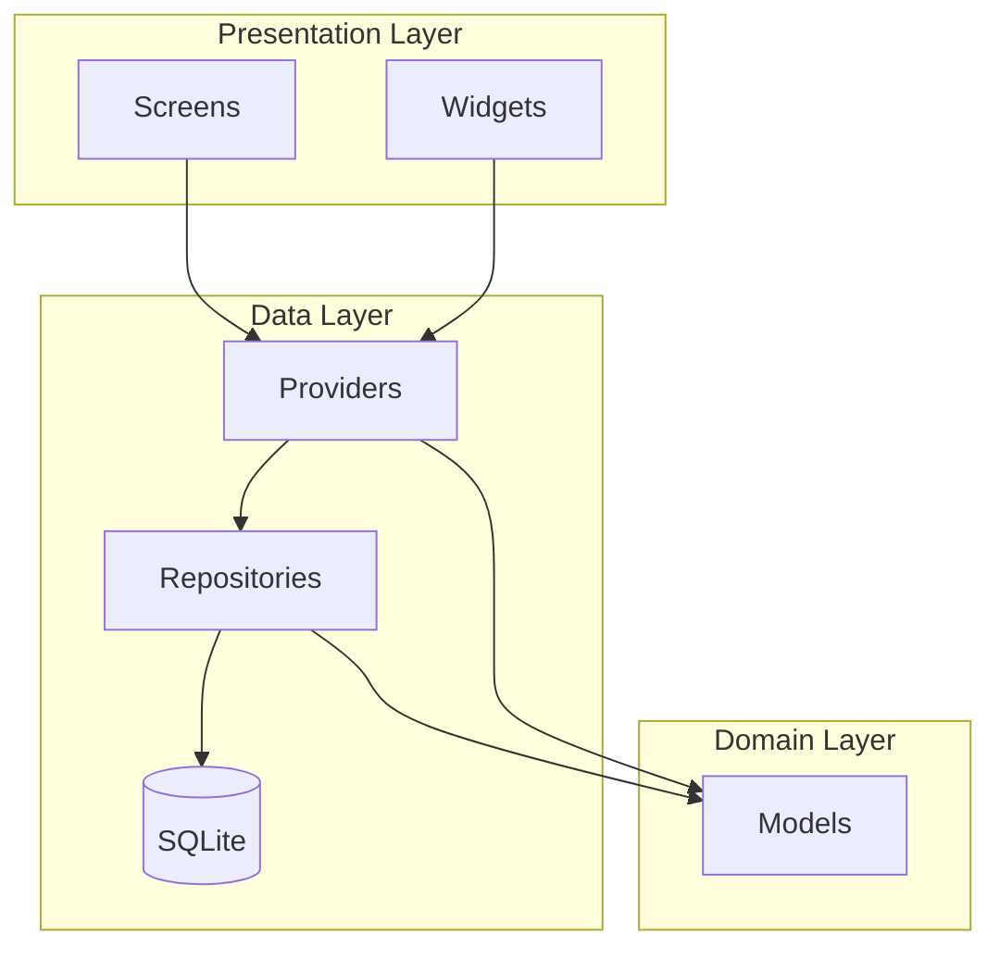
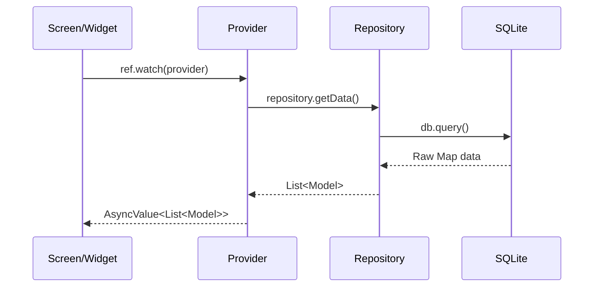
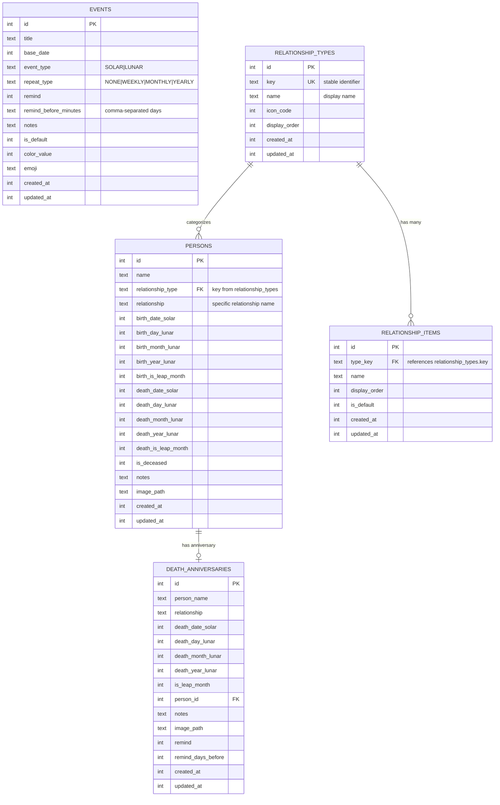
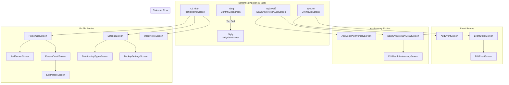
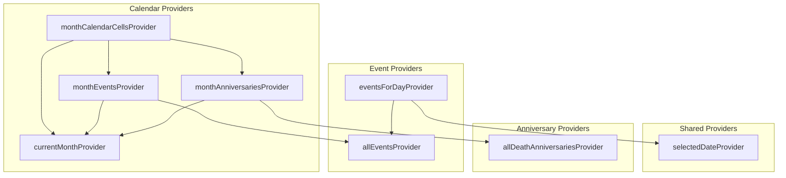
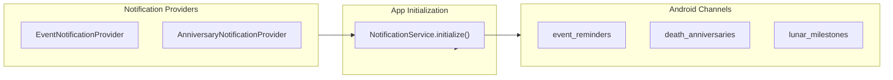
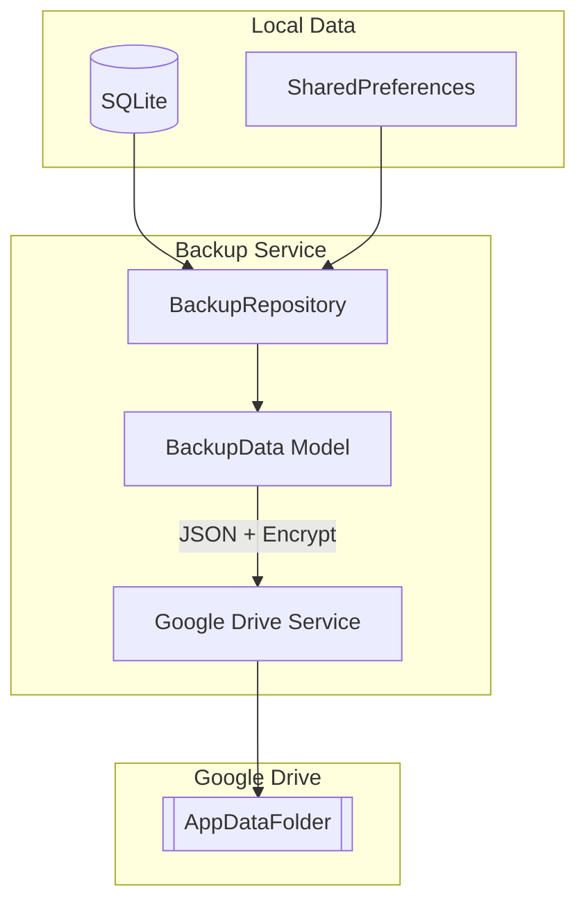

# Lịch Vạn Niên - Tài liệu Dự án Toàn diện

> **Mục đích**: Tài liệu bàn giao dự án cho developer tiếp nhận.  
> **Ngày tạo**: 2026-01-04  
> **Phiên bản app**: 1.0.1+2

---

## Mục lục

1. [Tổng quan Ứng dụng](#1-tổng-quan-ứng-dụng)
2. [Cấu trúc Dự án](#2-cấu-trúc-dự-án)
3. [Kiến trúc Kỹ thuật](#3-kiến-trúc-kỹ-thuật)
4. [Mô hình Dữ liệu & Quan hệ](#4-mô-hình-dữ-liệu--quan-hệ)
5. [Các Tính năng & Màn hình](#5-các-tính-năng--màn-hình)
6. [Luồng Điều hướng](#6-luồng-điều-hướng)
7. [State Management (Riverpod)](#7-state-management-riverpod)
8. [Database & Migration](#8-database--migration)
9. [Hệ thống Thông báo](#9-hệ-thống-thông-báo)
10. [Backup & Restore](#10-backup--restore)
11. [Hướng dẫn Phát triển](#11-hướng-dẫn-phát-triển)

---

## 1. Tổng quan Ứng dụng

### 1.1 Mô tả
**Lịch Vạn Niên** là ứng dụng lịch âm lịch Việt Nam, hỗ trợ:
- Xem lịch âm-dương đồng thời
- Quản lý sự kiện (lễ hội, sinh nhật, ...)
- Quản lý ngày giỗ (Ngày Giỗ - Death Anniversary)
- Quản lý thông tin người thân
- Nhắc nhở tự động

### 1.2 Tech Stack

| Thành phần | Công nghệ | Phiên bản |
|------------|-----------|-----------|
| Framework | Flutter | 3.9+ |
| Language | Dart | 3.0+ |
| State Management | flutter_riverpod | 2.5.1 |
| Database | sqflite | 2.3.2 |
| Navigation | go_router | 13.2.0 |
| Lunar Algorithm | vnlunar | 1.1.1 |
| Notifications | flutter_local_notifications | 18.0.1 |
| Backup | google_sign_in + googleapis | Latest |
| Ads | google_mobile_ads | 7.0.0 |

### 1.3 Nguyên tắc Thiết kế

1. **Offline-First**: Mọi tính toán âm lịch chạy local, không cần internet
2. **Algorithm-Based**: Dùng thuật toán Hồ Ngọc Đức cho âm lịch
3. **Clean Architecture**: Feature-first với data/domain/presentation layers
4. **Reactive UI**: Dùng Riverpod với code generation

---

## 2. Cấu trúc Dự án

```
lib/
├── main.dart                    # Entry point
├── core/                        # Core utilities
│   ├── algorithm/
│   │   └── lunar_algo.dart      # Thuật toán âm lịch (vnlunar wrapper)
│   ├── constants/
│   │   └── app_colors.dart      # Màu sắc
│   ├── routing/
│   │   ├── app_router.dart      # go_router configuration
│   │   └── routes.dart          # Route constants
│   ├── services/
│   │   └── notification_service.dart  # Local notifications
│   └── theme/
│       └── app_theme.dart       # Theme configuration
│
├── features/                    # Feature modules (Clean Architecture)
│   ├── backup/                  # Backup/Restore to Google Drive
│   ├── calendar/                # Calendar views (Daily/Monthly)
│   ├── death_anniversary/       # Ngày Giỗ management
│   ├── events/                  # Events & Holidays
│   └── profile/                 # Profile, Persons, Settings
│
└── shared/                      # Shared resources
    ├── models/
    │   ├── lunar_date.dart      # LunarDate (output of algorithm)
    │   └── calendar_cell.dart   # CalendarCell (grid display)
    ├── providers/
    │   └── date_providers.dart  # Selected date state
    └── widgets/
        └── lunar_calendar_bottom_sheet.dart  # Custom date picker
```

### Mỗi Feature Module có cấu trúc:

```
feature_name/
├── data/
│   ├── database/                # Database helper (chỉ events có)
│   ├── providers/               # Riverpod providers
│   ├── repositories/            # Data access layer
│   └── services/                # Feature-specific services
├── domain/
│   └── models/                  # Domain models
└── presentation/
    ├── screens/                 # Screen widgets
    └── widgets/                 # Feature-specific widgets
```

---

## 3. Kiến trúc Kỹ thuật

### 3.1 Clean Architecture Diagram



### 3.2 Luồng Dữ liệu



### 3.3 Cách Update UI

**Pattern: Riverpod với Code Generation**

```dart
// 1. Define provider (calendar_providers.dart)
@riverpod
class CurrentMonth extends _$CurrentMonth {
  @override
  DateTime build() => DateTime.now();
  
  void nextMonth() {
    state = DateTime(state.year, state.month + 1);
  }
}

// 2. Use in UI
class MonthlyGridScreen extends ConsumerWidget {
  @override
  Widget build(BuildContext context, WidgetRef ref) {
    final currentMonth = ref.watch(currentMonthProvider);
    // UI rebuilds when currentMonth changes
  }
}

// 3. Trigger update
ref.read(currentMonthProvider.notifier).nextMonth();
```

**Invalidation Pattern cho Database Changes**:
```dart
// Sau khi thêm/sửa/xóa data, invalidate related providers
await repository.createEvent(event);
ref.invalidate(allEventsProvider);
ref.invalidate(monthEventsProvider);
```

---

## 4. Mô hình Dữ liệu & Quan hệ

### 4.1 Entity Relationship Diagram



### 4.2 Domain Models Chi Tiết

#### Event (lib/features/events/domain/models/event.dart)
```dart
class Event {
  final int? id;
  final String title;
  final DateTime baseDate;          // Ngày gốc
  final EventType type;             // SOLAR hoặc LUNAR
  final RepeatType repeat;          // NONE, WEEKLY, MONTHLY, YEARLY
  final bool remind;
  final List<int> remindDaysList;   // [7, 3, 1] = nhắc trước 7, 3, 1 ngày
  final String? notes;
  final bool isDefault;             // true = holiday mặc định
  final int? colorValue;
  final String? emoji;
  final DateTime createdAt;
  final DateTime updatedAt;
}

enum EventType { solar, lunar }
enum RepeatType { none, weekly, monthly, yearly }
```

#### Person (lib/features/profile/domain/models/person.dart)
```dart
class Person {
  final int? id;
  final String name;
  final String relationshipType;    // 'family', 'friends', 'colleagues'
  final String? relationship;       // 'Ba', 'Mẹ', 'Anh', ...
  
  // Birth date (optional)
  final DateTime? birthDateSolar;
  final int? birthDayLunar;
  final int? birthMonthLunar;
  final int? birthYearLunar;
  final bool? birthIsLeapMonth;
  
  // Death date (optional - for deceased persons)
  final DateTime? deathDateSolar;
  final int? deathDayLunar;
  final int? deathMonthLunar;
  final int? deathYearLunar;
  final bool? deathIsLeapMonth;
  
  final bool isDeceased;
  final String? notes;
  final String? imagePath;
  final DateTime createdAt;
  final DateTime updatedAt;
  
  int? get age;                     // Calculated property
  bool get isAlive;
}
```

#### DeathAnniversary (lib/features/death_anniversary/domain/models/death_anniversary.dart)
```dart
class DeathAnniversary {
  final int? id;
  final String personName;
  final String? relationship;
  final DateTime deathDateSolar;
  final int deathDayLunar;          // Ngày giỗ âm lịch
  final int deathMonthLunar;
  final int deathYearLunar;
  final bool isLeapMonth;           // Tháng nhuận
  final int? personId;              // Link to Person (optional)
  final String? notes;
  final String? imagePath;
  final bool remind;
  final List<int> remindDaysList;
  final DateTime createdAt;
  final DateTime updatedAt;
}
```

#### LunarDate (lib/shared/models/lunar_date.dart)
```dart
/// Output của thuật toán âm lịch - KHÔNG lưu database
class LunarDate {
  final int day;                    // 1-30
  final int month;                  // 1-12
  final int year;
  final bool isLeapMonth;           // Tháng nhuận
  
  // Can Chi (Thiên Can Địa Chi)
  final String canDay;              // Giáp, Ất, ...
  final String chiDay;              // Tý, Sửu, ...
  final String canMonth;
  final String chiMonth;
  final String canYear;
  final String chiYear;
  
  final String? solarTerm;          // Tiết khí (nếu có)
}
```

#### CalendarCell (lib/shared/models/calendar_cell.dart)
```dart
/// Cell trong lưới tháng
class CalendarCell {
  final DateTime solarDate;
  final LunarDate lunarDate;
  final bool isCurrentMonth;        // Thuộc tháng hiện tại
  final bool isToday;
  final bool hasEvent;
  final int eventCount;
  final bool hasAnniversary;
  final int anniversaryCount;
}
```

---

## 5. Các Tính năng & Màn hình

### 5.1 Bảng Tổng hợp Màn hình

| Tab | Màn hình | File | Mô tả |
|-----|----------|------|-------|
| **Ngày** | DailyViewScreen | `calendar/presentation/screens/daily_view_screen.dart` | Xem chi tiết 1 ngày |
| **Tháng** | MonthlyGridScreen | `calendar/presentation/screens/monthly_grid_screen.dart` | Lưới tháng 6x7 |
| **Sự Kiện** | EventsListScreen | `events/presentation/screens/events_list_screen.dart` | Danh sách sự kiện |
| | AddEventScreen | `events/presentation/screens/add_event_screen.dart` | Thêm/Sửa sự kiện |
| | EventDetailScreen | `events/presentation/screens/event_detail_screen.dart` | Chi tiết sự kiện |
| **Ngày Giỗ** | DeathAnniversaryListScreen | `death_anniversary/presentation/screens/death_anniversary_list_screen.dart` | Danh sách ngày giỗ |
| | AddDeathAnniversaryScreen | `death_anniversary/presentation/screens/add_death_anniversary_screen.dart` | Thêm/Sửa ngày giỗ |
| | DeathAnniversaryDetailScreen | `death_anniversary/presentation/screens/death_anniversary_detail_screen.dart` | Chi tiết ngày giỗ |
| **Cá nhân** | ProfileHomeScreen | `profile/presentation/screens/profile_home_screen.dart` | Menu profile |
| | PersonListScreen | `profile/presentation/screens/person_list_screen.dart` | Danh sách người thân |
| | AddPersonScreen | `profile/presentation/screens/add_person_screen.dart` | Thêm người |
| | EditPersonScreen | `profile/presentation/screens/edit_person_screen.dart` | Sửa người |
| | PersonDetailScreen | `profile/presentation/screens/person_detail_screen.dart` | Chi tiết người |
| | SettingsScreen | `profile/presentation/screens/settings_screen.dart` | Cài đặt |
| | RelationshipTypesScreen | `profile/presentation/screens/relationship_types_screen.dart` | Quản lý loại quan hệ |
| | BackupSettingsScreen | `backup/presentation/screens/backup_settings_screen.dart` | Backup/Restore |
| | UserProfileScreen | `profile/presentation/screens/user_profile_screen.dart` | Thông tin cá nhân |

### 5.2 Chi tiết Từng Tính năng

#### A. Calendar (Lịch)
- **Daily View**: Hiển thị ngày dương, ngày âm, Can Chi, tiết khí
- **Monthly Grid**: Lưới 6x7 cells với event/anniversary indicators
- **Navigation**: Previous/Next day/month, Today button
- **Date Selection**: Tap cell để xem chi tiết ngày

#### B. Events (Sự kiện)
- **Types**: Solar (dương lịch) hoặc Lunar (âm lịch)
- **Repeat**: None, Weekly, Monthly, Yearly
- **Default Events**: Holidays được seed sẵn (không xóa được)
- **Reminders**: Multi-day reminders (7, 3, 1 ngày trước)
- **Color & Emoji**: Tùy chỉnh màu và emoji

#### C. Death Anniversary (Ngày Giỗ)
- **Lunar-based**: Luôn dựa trên ngày âm lịch
- **Person Link**: Có thể link với Person records
- **Leap Month**: Hỗ trợ tháng nhuận
- **Anniversary Calculation**: Tự động tính năm thứ mấy

#### D. Profile & Persons
- **Relationship Types**: Gia đình, Bạn bè, Đồng nghiệp (extensible)
- **Relationship Items**: Ba, Mẹ, Anh, ... (per type)
- **Person Info**: Sinh/Mất (optional), cả âm và dương lịch
- **Age Calculation**: Tự động tính tuổi

#### E. Backup/Restore
- **Google Drive**: Backup lên Drive cá nhân
- **Encryption**: Mã hóa với password tùy chọn
- **Data**: Events, Persons, Anniversaries, Settings

---

## 6. Luồng Điều hướng

### 6.1 Navigation Architecture



### 6.2 Route Definitions

Xem file: `lib/core/routing/app_router.dart`

```dart
// Bottom Navigation Routes
AppRoutes.daily           = '/'
AppRoutes.monthly         = '/monthly'
AppRoutes.events          = '/events'
AppRoutes.deathAnniversaries = '/death-anniversaries'
AppRoutes.profile         = '/profile'

// Full-screen Routes (outside bottom nav)
'/events/add'
'/events/detail'         // extra: Event
'/events/edit'           // extra: Event
'/death-anniversaries/add'
'/death-anniversaries/:id'
'/death-anniversaries/:id/edit'
'/profile/persons'
'/profile/persons/add'
'/profile/persons/:id'
'/profile/persons/:id/edit'
'/profile/settings'
'/profile/settings/relationship-types'
'/profile/settings/backup'
'/profile/my-profile'
```

---

## 7. State Management (Riverpod)

### 7.1 Provider Types Used

| Type | Use Case | Example |
|------|----------|---------|
| `@riverpod` | Auto-dispose, computed | `allEventsProvider` |
| `@Riverpod(keepAlive: true)` | Persist state | `selectedDateProvider` |
| `Notifier` | Mutable state with methods | `CurrentMonth` |
| `FutureProvider` | Async one-time fetch | `personByIdProvider` |
| `StreamProvider` | Reactive updates | (not used) |

### 7.2 Key Providers

#### Calendar Providers (`lib/features/calendar/data/providers/calendar_providers.dart`)
```dart
// Current selected month
@riverpod
class CurrentMonth extends _$CurrentMonth {
  DateTime build() => DateTime.now();
  void nextMonth() { ... }
  void previousMonth() { ... }
  void today() { ... }
}

// Calendar cells for the month
@riverpod
List<CalendarCell> monthCalendarCells(ref) { ... }

// Events grouped by date for the month
@riverpod
Map<String, int> monthEvents(ref) { ... }
```

#### Date Providers (`lib/shared/providers/date_providers.dart`)
```dart
// Currently selected date (shared across features)
@Riverpod(keepAlive: true)
class SelectedDate extends _$SelectedDate {
  DateTime build() => DateTime.now();
  void setDate(DateTime date) { ... }
}
```

#### Event Providers (`lib/features/events/data/providers/event_providers.dart`)
```dart
@riverpod
Future<List<Event>> allEvents(ref) async {
  final repository = EventRepository();
  return repository.getAllEvents();
}

@riverpod
Future<List<Event>> eventsForDay(ref, DateTime date) async { ... }
```

### 7.3 Provider Dependency Graph



---

## 8. Database & Migration

### 8.1 Database Info

- **File**: `amlich.db`
- **Location**: App documents directory
- **Current Version**: 10
- **Tables**: 5 (events, persons, death_anniversaries, relationship_types, relationship_items)

### 8.2 Migration History

| Version | Changes |
|---------|---------|
| 1 | Initial: events table |
| 2 | Add persons table |
| 3 | Add person_id to death_anniversaries |
| 4 | Add relationship_types table |
| 5 | Add key column to relationship_types |
| 6 | Add is_deceased to persons |
| 7 | Make birth fields nullable |
| 8 | Add isDefault, colorValue, emoji to events + seed holidays |
| 9 | Add relationship_items table |
| 10 | Seed lunar holidays (Tết, Trung Thu, ...) |

### 8.3 Default Data (Seeded)

#### Solar Holidays
- Tết Dương Lịch (01/01)
- Quốc tế Phụ nữ (08/03)
- Quốc tế Lao động (01/05)
- Quốc tế Thiếu nhi (01/06)
- Giáng Sinh (25/12)

#### Lunar Holidays
- Tết Nguyên Đán (01/01 ÂL)
- Tết Nguyên Tiêu (15/01 ÂL)
- Tết Hàn Thực (03/03 ÂL)
- Giỗ Tổ Hùng Vương (10/03 ÂL)
- Lễ Phật Đản (15/04 ÂL)
- Tết Đoan Ngọ (05/05 ÂL)
- Lễ Vu Lan (15/07 ÂL)
- Tết Trung Thu (15/08 ÂL)
- Tết Trùng Cửu (09/09 ÂL)
- Tết Trùng Thập (10/10 ÂL)
- Ông Công Ông Táo (23/12 ÂL)

#### Relationship Types
- Gia đình (family)
- Bạn bè (friends)
- Đồng nghiệp (colleagues)

#### Relationship Items (Family)
- Ba/Cha, Mẹ/Má, Anh, Chị, Em, Con, Ông Nội, Ông Ngoại, Bà Nội, Bà Ngoại

---

## 9. Hệ thống Thông báo

### 9.1 Architecture



### 9.2 Notification Flow

1. **App Start**: Initialize notification service, request permissions
2. **Data Change**: When event/anniversary is created/updated, reschedule notifications
3. **Scheduling**: Use `flutter_local_notifications` with timezone support
4. **Multi-day**: Schedule multiple notifications per event (7, 3, 1 days before)

### 9.3 Key Files
- `lib/core/services/notification_service.dart` - Core service
- `lib/features/events/data/providers/event_notification_providers.dart`
- `lib/features/death_anniversary/data/providers/anniversary_notification_providers.dart`

---

## 10. Backup & Restore

### 10.1 Architecture



### 10.2 Backup Data Structure

```dart
class BackupData {
  String appVersion;
  int schemaVersion;
  DateTime createdAt;
  String? deviceInfo;
  
  List<Map> events;           // User events only
  List<Map> persons;
  List<Map> deathAnniversaries;
  List<Map> relationshipTypes;
  List<Map> relationshipItems;
  Map? userProfile;           // From SharedPreferences
}
```

### 10.3 Key Files
- `lib/features/backup/data/repositories/backup_repository.dart`
- `lib/features/backup/data/services/google_drive_service.dart`
- `lib/features/backup/domain/models/backup_data.dart`

---

## 11. Hướng dẫn Phát triển

### 11.1 Setup Development

```bash
# Clone repository
git clone <repo_url>
cd lichviet

# Install dependencies
flutter pub get

# Run code generation (Riverpod)
flutter pub run build_runner build --delete-conflicting-outputs

# Run app
flutter run
```

### 11.2 Code Generation

Khi thêm/sửa providers với `@riverpod` annotation:

```bash
# One-time build
flutter pub run build_runner build --delete-conflicting-outputs

# Watch mode (auto-rebuild)
flutter pub run build_runner watch --delete-conflicting-outputs
```

### 11.3 Testing

```bash
# Run all tests
flutter test

# Run specific test file
flutter test test/event_repository_test.dart

# Run with coverage
flutter test --coverage
```

### 11.4 Build Release

```bash
# Android APK
flutter build apk --release

# Android App Bundle
flutter build appbundle --release

# iOS
flutter build ios --release
```

### 11.5 Key Conventions

1. **Date Picker**: LUÔN dùng `LunarCalendarBottomSheet` thay vì `showDatePicker()`
2. **Vietnamese Comments**: Dùng cho business logic
3. **English Comments**: Dùng cho technical implementation
4. **Provider Naming**: `xxxProvider` cho read-only, `XxxNotifier` cho mutable
5. **Route Names**: Định nghĩa trong `routes.dart`, không hardcode

### 11.6 Known Issues

Xem file: `KNOWN_ISSUES.md`

---

## Phụ lục

### A. Lunar Algorithm

- **Package**: vnlunar (1.1.1)
- **Author**: Dr. Hồ Ngọc Đức
- **Accuracy**: 1800-2199
- **Timezone**: GMT+7 (Vietnam)
- **Features**:
  - Solar ↔ Lunar conversion
  - Leap month detection
  - Can Chi calculation
  - Solar terms (Tiết khí)

### B. Quan trọng cho Developer Mới

1. **Hiểu Lunar vs Solar**: Events có thể là lunar-based, matching logic phức tạp
2. **Riverpod Code Gen**: Phải chạy build_runner sau khi sửa providers
3. **Database Migration**: Thêm version mới khi thay đổi schema
4. **Navigation**: go_router với StatefulShellRoute giữ state các tabs

### C. Tài liệu Tham khảo

- [Flutter Riverpod](https://riverpod.dev/)
- [go_router](https://pub.dev/packages/go_router)
- [sqflite](https://pub.dev/packages/sqflite)
- [vnlunar](https://pub.dev/packages/vnlunar)
- [Ho Ngoc Duc Algorithm](https://www.informatik.uni-leipzig.de/~duc/amlich/)
