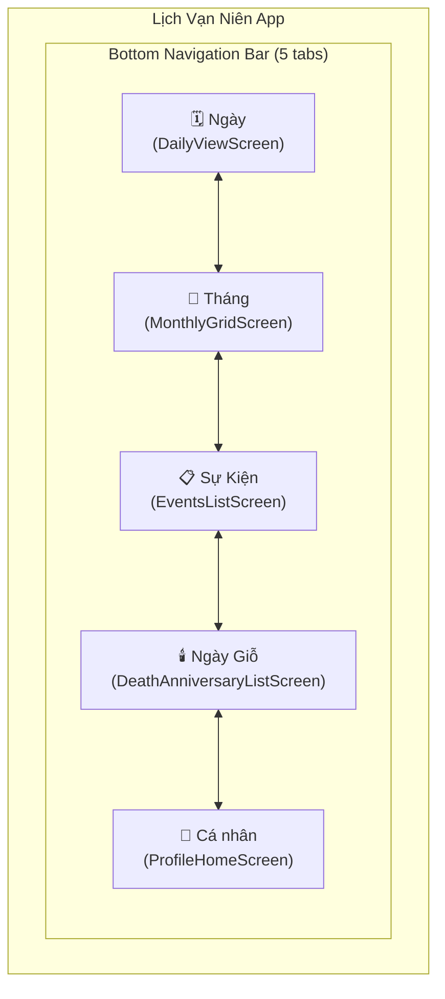
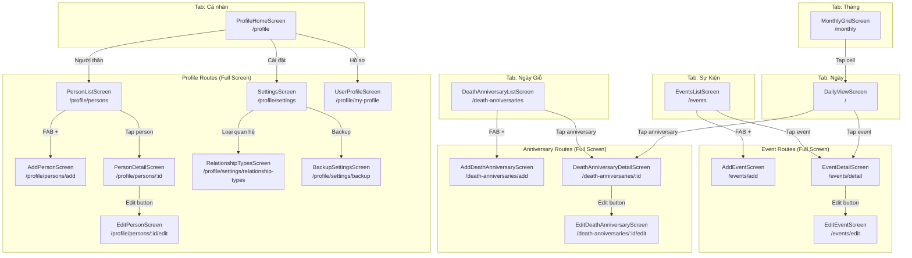
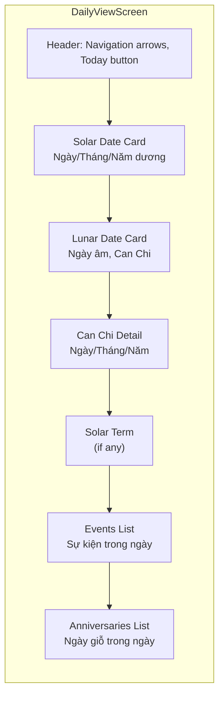
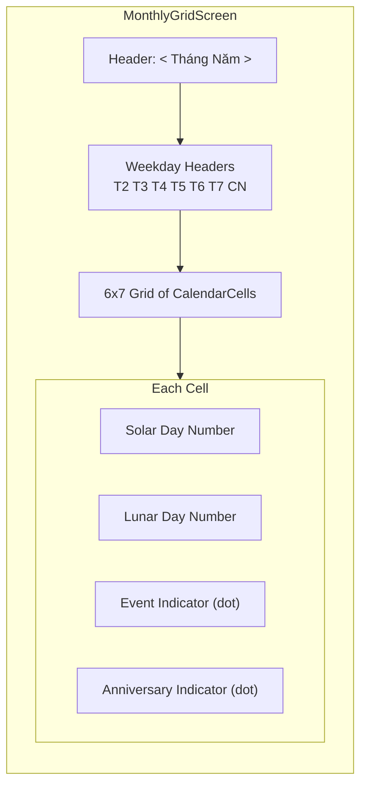
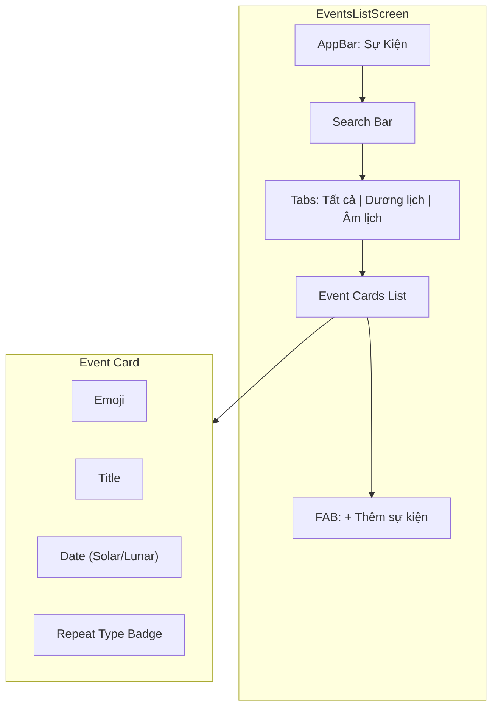
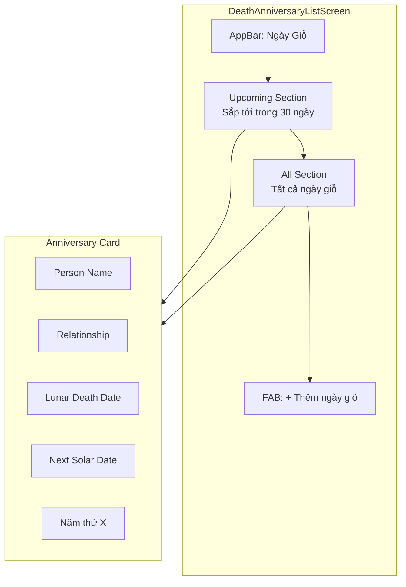
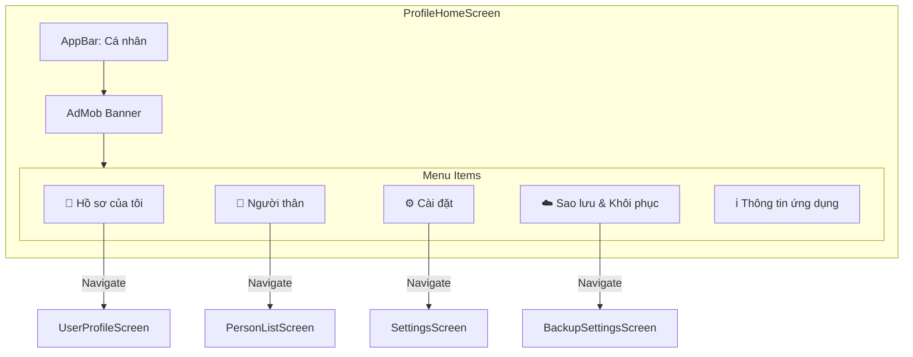
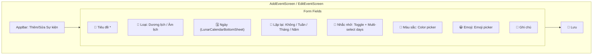
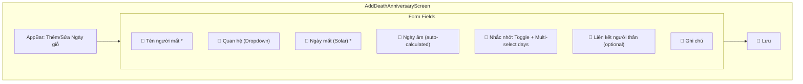
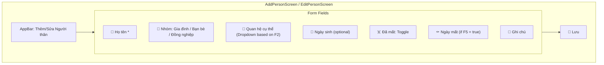

# Lịch Vạn Niên - Sơ đồ Màn hình & Điều hướng

## 1. Bottom Navigation Structure



---

## 2. Complete Navigation Flow



---

## 3. Screen Details

### 3.1 Tab: Ngày (Daily View)



### 3.2 Tab: Tháng (Monthly Grid)



### 3.3 Tab: Sự Kiện (Events)



### 3.4 Tab: Ngày Giỗ (Anniversaries)



### 3.5 Tab: Cá nhân (Profile)



---

## 4. Form Screens

### 4.1 Add/Edit Event Screen



### 4.2 Add/Edit Death Anniversary Screen



### 4.3 Add/Edit Person Screen



---

## 5. Route Configuration

### 5.1 Route Constants

```dart
// lib/core/routing/routes.dart

class AppRoutes {
  // Bottom Navigation Routes
  static const String daily = '/';
  static const String monthly = '/monthly';
  static const String events = '/events';
  static const String deathAnniversaries = '/death-anniversaries';
  static const String profile = '/profile';
  
  // Full-screen Routes
  static const String backupSettings = '/profile/settings/backup';
  static const String myProfile = '/profile/my-profile';
}

class RouteNames {
  static const String daily = 'daily';
  static const String monthly = 'monthly';
  static const String events = 'events';
  static const String deathAnniversaries = 'deathAnniversaries';
  static const String profile = 'profile';
  
  static const String addEvent = 'addEvent';
  static const String eventDetail = 'eventDetail';
  static const String editEvent = 'editEvent';
  
  static const String addDeathAnniversary = 'addDeathAnniversary';
  static const String deathAnniversaryDetail = 'deathAnniversaryDetail';
  static const String editDeathAnniversary = 'editDeathAnniversary';
  
  static const String personList = 'personList';
  static const String addPerson = 'addPerson';
  static const String personDetail = 'personDetail';
  static const String editPerson = 'editPerson';
  
  static const String settings = 'settings';
  static const String relationshipTypes = 'relationshipTypes';
  static const String backupSettings = 'backupSettings';
  static const String myProfile = 'myProfile';
}
```

### 5.2 Navigation Examples

```dart
// Navigate to add event
context.pushNamed(RouteNames.addEvent);

// Navigate to event detail (passing event object)
context.pushNamed(
  RouteNames.eventDetail,
  extra: event,
);

// Navigate to person detail (passing ID in path)
context.pushNamed(
  RouteNames.personDetail,
  pathParameters: {'id': person.id.toString()},
);

// Pop back
context.pop();

// Go to root (daily view)
context.go(AppRoutes.daily);
```

---

## 6. Screen Files Location

| Screen | File Path |
|--------|-----------|
| DailyViewScreen | `lib/features/calendar/presentation/screens/daily_view_screen.dart` |
| MonthlyGridScreen | `lib/features/calendar/presentation/screens/monthly_grid_screen.dart` |
| EventsListScreen | `lib/features/events/presentation/screens/events_list_screen.dart` |
| AddEventScreen | `lib/features/events/presentation/screens/add_event_screen.dart` |
| EditEventScreen | `lib/features/events/presentation/screens/edit_event_screen.dart` |
| EventDetailScreen | `lib/features/events/presentation/screens/event_detail_screen.dart` |
| DeathAnniversaryListScreen | `lib/features/death_anniversary/presentation/screens/death_anniversary_list_screen.dart` |
| AddDeathAnniversaryScreen | `lib/features/death_anniversary/presentation/screens/add_death_anniversary_screen.dart` |
| EditDeathAnniversaryScreen | `lib/features/death_anniversary/presentation/screens/edit_death_anniversary_screen.dart` |
| DeathAnniversaryDetailScreen | `lib/features/death_anniversary/presentation/screens/death_anniversary_detail_screen.dart` |
| ProfileHomeScreen | `lib/features/profile/presentation/screens/profile_home_screen.dart` |
| PersonListScreen | `lib/features/profile/presentation/screens/person_list_screen.dart` |
| AddPersonScreen | `lib/features/profile/presentation/screens/add_person_screen.dart` |
| EditPersonScreen | `lib/features/profile/presentation/screens/edit_person_screen.dart` |
| PersonDetailScreen | `lib/features/profile/presentation/screens/person_detail_screen.dart` |
| SettingsScreen | `lib/features/profile/presentation/screens/settings_screen.dart` |
| RelationshipTypesScreen | `lib/features/profile/presentation/screens/relationship_types_screen.dart` |
| BackupSettingsScreen | `lib/features/backup/presentation/screens/backup_settings_screen.dart` |
| UserProfileScreen | `lib/features/profile/presentation/screens/user_profile_screen.dart` |

---

## 7. Important UI Components

### 7.1 LunarCalendarBottomSheet

> **QUY ƯỚC QUAN TRỌNG**: Tất cả date picker trong app PHẢI dùng `LunarCalendarBottomSheet`

```dart
// lib/shared/widgets/lunar_calendar_bottom_sheet.dart

// Usage:
final DateTime? picked = await LunarCalendarBottomSheet.show(
  context,
  initialDate: _selectedDate,
  firstDate: DateTime(1900),
  lastDate: DateTime(2100),
);

if (picked != null) {
  setState(() => _selectedDate = picked);
}
```

**Features:**
- Hiển thị âm lịch dưới mỗi ngày dương
- Chọn năm/tháng nhanh (tap tiêu đề)
- Nút "Hôm nay" để nhảy về hiện tại
- Highlight ngày đầu tháng âm
- Xác nhận hiển thị ngày đã chọn
